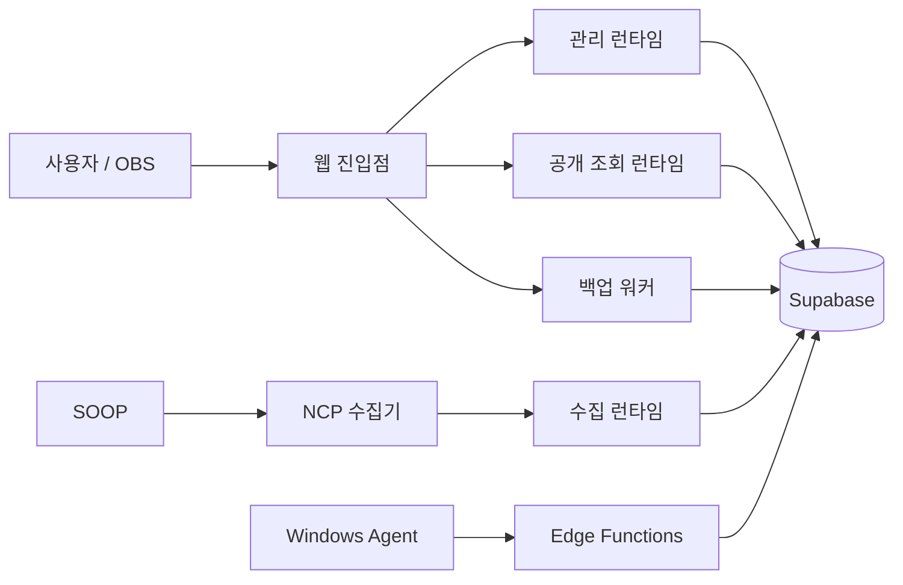

# 구조와 설계 결정

## 하나의 기준, 분리된 실행 권한

소스 통합과 운영 권한 통합은 별개입니다. 사용자 화면, 관리자, 수집기, 공개 조회, 백업을 동일한 비밀키로 묶지 않습니다. Vercel의 다섯 프로젝트, NCP 지속 실행 수집기, Supabase, Windows Agent의 실행 경계를 유지합니다.

## ADR-001: 운영 소스로부터 통합

과거 개발 폴더에는 서로 다른 시점의 소스와 배포 연결 정보가 섞여 있었습니다. 가장 최근 수정된 폴더라는 이유만으로 운영 기준으로 삼을 수 없었습니다.

사용자가 인정한 운영 안정본을 보존하고, 구성요소별 해시 목록을 만든 뒤 새 작업 트리로 복사했습니다. `source-manifest.json`은 원본과 허용된 수정 3건을 기록합니다. `npm run verify:source`가 이를 검사합니다. 다음 버전에서 의도적으로 변경하는 파일은 PR에서 manifest도 함께 갱신해야 합니다.

## ADR-002: 공통 패키지 추출 유보

초기 통합에서는 각 앱의 의존성·lockfile·API 경로를 유지합니다. 같은 이름의 모듈이라도 권한과 배포 시점이 다르므로, 중복이라는 이유만으로 합치지 않습니다. 공통화는 호출자·권한·동작 비교를 갖춘 별도 변경으로 진행합니다.

## ADR-003: 데이터베이스 이력의 기준

루트 `supabase/`가 2026-09-23 확인한 운영 기준입니다. 적용된 SQL 이력 193개와 Edge Function 3개의 당시 소스를 보관합니다. 이번 작업에서는 SQL과 함수를 재적용하지 않았으며 회원 데이터를 추출하지 않았습니다.

`apps/web/supabase/` 등 구성요소 내부의 과거 사본은 원본 보존·기존 검사 때문에 남아 있습니다. 해당 경로에서 DB/Edge 배포를 실행하지 않습니다. 마이그레이션 이력에는 기존 스키마를 전제로 한 변경도 있으므로, 새 빈 DB 전체 복원이 검증된 설치 스크립트로 간주하지 않습니다.

## ADR-004: 구버전 정리 기준

현재 다운로드·업데이트 피드, 사용 중인 Agent, 호환성 전환 버전, 직전 복구 버전은 보존합니다. 제거할 파일은 참조와 해시를 확인하고 개인 로컬 복구 사본을 남깁니다. 검사에 필요한 과거 자료는 `test-support/`와 `AgentStoreTests/legacy-fixtures/`에 격리하며 운영 실행 코드에 편입하지 않습니다.
